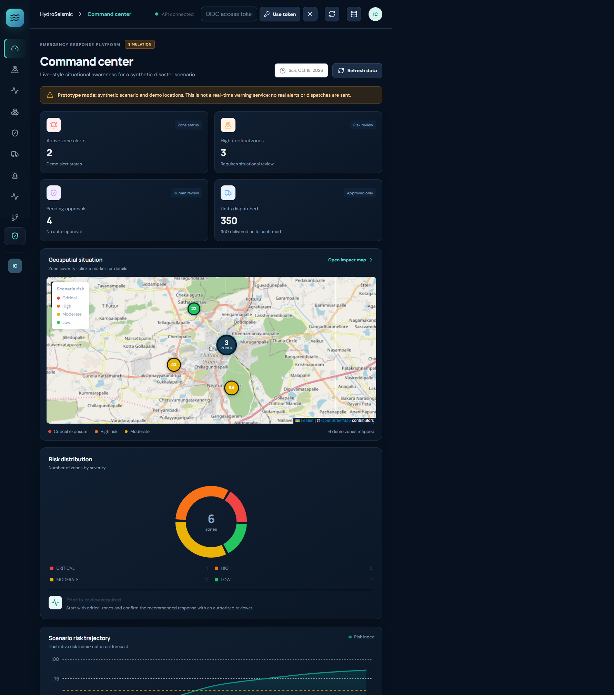
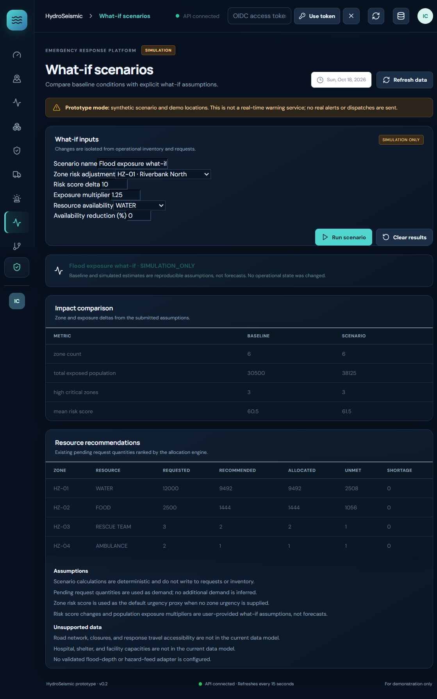
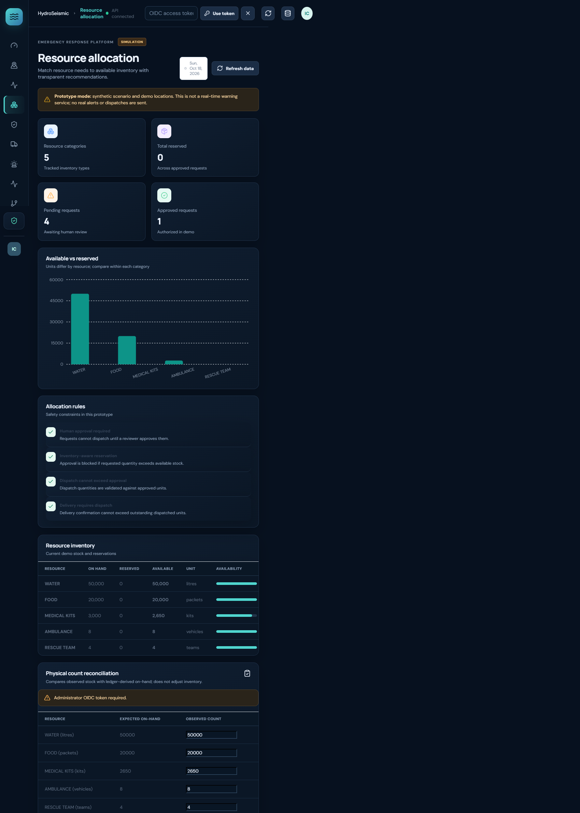
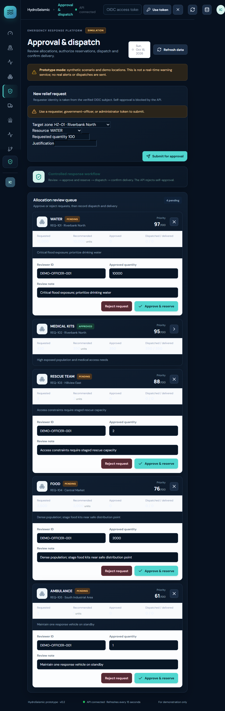
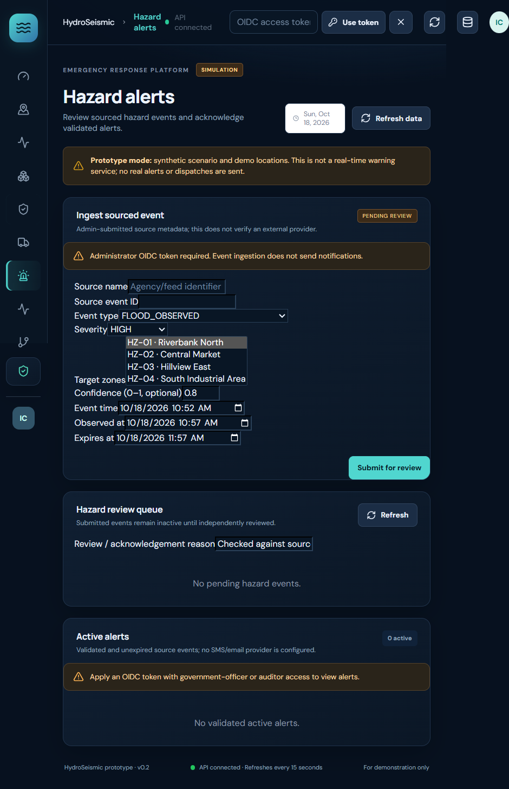

# HydroSeismic

HydroSeismic is a disaster-response coordination project built with a Next.js operations dashboard and FastAPI backend. It provides zone-risk visualization, deterministic resource recommendations, role-protected request approval, inventory accounting, shipment tracking, reviewed hazard-event intake, what-if scenarios, and a local SHA-256 audit chain.

> **Project scope.** Included zone, population, risk, and inventory records are synthetic. The current implementation does not predict disasters, distribute official warnings, contact emergency services, or dispatch real resources.


## Problem statement

Floods and earthquakes can disrupt communities, infrastructure, healthcare, transport, and supply chains in a short time. Response teams must understand changing local impacts, identify urgent needs, distribute limited supplies, and coordinate decisions across organizations. When alerts, exposure estimates, requests, stock records, and response updates are fragmented or inconsistent, responders lack a shared operational picture and it is difficult to explain why resources were prioritized.

HydroSeismic addresses this coordination problem by bringing zone information and the relief-request lifecycle into one operational workflow. Its goal is to help responders move from **assess → prioritize → simulate → approve → account → review** with visible assumptions and an audit trail. The current project demonstrates this workflow using synthetic data; it is not a live disaster intelligence service.

## Capabilities

- **Command center and map:** synthetic zone metrics, risk distribution, OpenStreetMap display, impact filters, and risk explanations.
- **Resource recommendations:** deterministic weighted zone ranking with requested, recommended, allocated, unmet, shortage, and explanation fields. Recommendations are simulations, not approvals.
- **Request approval:** requests record the verified requester subject. A separate government officer or administrator must approve or reject with a reason. Self-approval is denied.
- **Inventory:** on-hand, reserved, available, dispatched, delivered, and shortage quantities; movement history; physical count reports; justified stock adjustments; and reservation release.
- **Dispatch:** legacy immediate-dispatch API plus explicit prepare, commit, transit, cancellation, delivery, failure, and return-to-stock reconciliation paths.
- **Hazard alerts:** administrator-submitted source events, independent review, expiry, deduplication, explicit zone targeting, and acknowledgements. External notifications are not configured.
- **What-if scenarios:** isolated baseline-versus-scenario metrics and allocation recommendations. Simulations do not modify stored workflow state.
- **Audit:** existing local hash chain extended with actor/reason fields, sequence checks, filtering, and pagination. This is not a deployed blockchain.
- **Fabric boundary:** injectable adapter contract that fails closed unless a Gateway client and Fabric configuration are supplied. No Fabric network is included.

## Screenshots

### Command center



### What-if scenario



### Resource allocation



### Request approval



### Hazard alerts



## Requirements

- Python 3.10 or newer
- Node.js 20.9 or newer
- Internet access to install packages and load OpenStreetMap tiles
- PowerShell on Windows, or equivalent shell commands for other operating systems

## Run locally

Open two terminals in the project directory.

### Backend

```powershell
Set-Location "$HOME\OneDrive\Desktop\hydroseismic-prototype\backend"
py -m venv .venv
.\.venv\Scripts\Activate.ps1
python -m pip install --upgrade pip
pip install -r requirements.txt
python -m uvicorn main:app --reload --port 8000
```

If PowerShell blocks virtual-environment activation, run `Set-ExecutionPolicy -Scope Process -ExecutionPolicy Bypass` and activate again. The API health endpoint is <http://127.0.0.1:8000/api/health>; interactive API documentation is <http://127.0.0.1:8000/docs>.

### Frontend

```powershell
Set-Location "$HOME\OneDrive\Desktop\hydroseismic-prototype\frontend"
npm install
npm run dev
```

Open <http://localhost:3000>. Set `NEXT_PUBLIC_API_URL` before starting Next.js only if the backend is not at `http://127.0.0.1:8000`.

## Configure OIDC authorization

The backend verifies externally issued OIDC access tokens; this repository does not include an identity provider or sign-in page. Set these values in the backend terminal before starting Uvicorn. Replace the example values with your provider’s **HTTPS** issuer, API audience, and JWKS URL:

```powershell
$env:HYDROSEISMIC_OIDC_ISSUER = "https://identity.example.org/"
$env:HYDROSEISMIC_OIDC_AUDIENCE = "hydroseismic-api"
$env:HYDROSEISMIC_OIDC_JWKS_URL = "https://identity.example.org/.well-known/jwks.json"
$env:HYDROSEISMIC_ROLE_CLAIM = "roles"
python -m uvicorn main:app --reload --port 8000
```

The API accepts `RS256` or `ES256` tokens and derives actor identity from the verified `sub` claim. The configured role claim may be a string or an array of strings. Supported canonical roles are `requester`, `government_officer`, `warehouse_staff`, `administrator`, and `auditor`; common aliases such as `admin`, `warehouse`, and `gov_officer` are normalized. Tokens must include `sub` and `exp`, and the API verifies issuer and audience.

The dashboard’s **OIDC access token** field accepts a short-lived token and keeps it only in browser memory; it is cleared on reload. This is token entry, not an authentication flow. Obtain the token from your configured identity provider. Never put a token or private key in source code or a `NEXT_PUBLIC_*` variable. The legacy `reviewer_id` and `officer_id` request-body fields are retained only for compatibility and never establish identity.

### Role permissions

| Role | Allowed actions |
|---|---|
| Requester | Create a relief request |
| Government officer | Create requests, review requests, validate hazard events, acknowledge alerts, and cancel unused approved allocations |
| Warehouse staff | Prepare/commit dispatch, record transit, delivery, and delivery failure; view shipment records |
| Administrator | Request, review, warehouse, inventory adjustment/reconciliation, hazard ingestion, and demo reset operations |
| Auditor | Read audit, inventory movement/reconciliation history, active alerts, and shipment records |

The backend is authoritative for access control. Hiding a frontend button is not a security boundary.

## Dashboard workflow

1. **Command center / Impact & map:** inspect synthetic zones and their exposed-population estimates.
2. **Resource allocation:** inspect available and reserved balances, compare physical counts, and submit a reasoned stock adjustment if authorized.
3. **Approval & dispatch:** create a request. Its owner is set by the backend from the token subject. A different authorized reviewer approves or rejects it with a mandatory reason.
4. **Shipments:** prepare an approved quantity, commit dispatch, mark it in transit, record delivery and any shortage, or report failure and reconcile eligible returns.
5. **Hazard alerts:** an administrator submits an event with source metadata and explicit zone IDs. A different government officer or administrator validates or rejects it. Validated, unexpired alerts can be acknowledged. No SMS/email/siren is sent.
6. **What-if scenarios:** adjust risk, exposure, and resource-availability assumptions. Results are simulation-only and do not change requests or stock.
7. **Audit ledger:** inspect integrity and events or export the displayed JSON data. The endpoint supports pagination and filters.

Protected actions require a configured OIDC provider and an appropriate token. The seeded requests are assigned to `system:demo-seed`; any other legacy request without `requester_id` fails closed for review until its owner is verified.

## API reference

All endpoints use the FastAPI API at `http://127.0.0.1:8000`. Protected routes require `Authorization: Bearer <access-token>`. FastAPI’s `/docs` page contains the exact request/response schemas.

### Public read and simulation routes

| Method and path | Purpose |
|---|---|
| `GET /api/health` | Health check |
| `GET /api/overview` | Dashboard totals |
| `GET /api/zones` | Synthetic zone data |
| `GET /api/allocations` | Relief requests |
| `GET /api/inventory` | Inventory balances |
| `POST /api/allocations/recommendations` | Deterministic simulation-only resource recommendations |
| `POST /api/scenarios/simulate` | Isolated baseline/what-if comparison |

### Requests, inventory, and allocations

| Method and path | Permission | Purpose |
|---|---|---|
| `POST /api/allocations` | Requester, government officer, administrator | Create an owned request; requester identity comes from token `sub` |
| `POST /api/allocations/{request_id}/review` | Government officer, administrator | Approve/reject with reason; reserves stock on approval; prevents self-review and repeated review |
| `POST /api/allocations/{request_id}/cancel` | Government officer, administrator | Release unused, undispatched reservation with reason |
| `POST /api/inventory/{resource}/adjustments` | Administrator | Apply a non-zero, reasoned stock adjustment; cannot consume reserved/dispatched stock |
| `POST /api/inventory/reconcile` | Administrator | Compare observed physical count with expected on-hand without changing stock |
| `GET /api/inventory/movements` | Auditor, administrator | Read movement history |
| `GET /api/inventory/reconciliations` | Auditor, administrator | Read persisted count reports |

The allocator supports the current resource definitions: `WATER`, `FOOD`, `MEDICAL_KITS`, `AMBULANCE`, and `RESCUE_TEAM`. Shelter inventory is not present. The recommendation request supplies scenario inputs and stock quantities, so its result is not authoritative for operational allocation; actual approval rechecks server-held inventory under a lock.

### Dispatch and delivery

| Method and path | Permission | Purpose |
|---|---|---|
| `POST /api/allocations/{request_id}/dispatch` | Warehouse staff, administrator | Backward-compatible immediate dispatch; creates a shipment record |
| `POST /api/allocations/{request_id}/prepare-dispatch` | Warehouse staff, administrator | Hold approved quantity in `PREPARED` state without consuming on-hand stock |
| `POST /api/dispatches/{dispatch_id}/dispatch` | Warehouse staff, administrator | Commit a prepared shipment; this is the stock-consumption point |
| `POST /api/dispatches/{dispatch_id}/cancel` | Warehouse staff, administrator | Cancel a `PREPARED` shipment without consuming stock |
| `POST /api/allocations/{request_id}/delivery` | Warehouse staff, administrator | Confirm actual delivered quantity and optional shortage with reason |
| `POST /api/dispatches/{dispatch_id}/transit` | Warehouse staff, administrator | Record `IN_TRANSIT` transition |
| `POST /api/dispatches/{dispatch_id}/failure` | Warehouse staff, administrator | Record failed delivery with reason |
| `POST /api/dispatches/{dispatch_id}/reconcile` | Administrator | Return eligible, undelivered quantity to inventory with reason |
| `GET /api/dispatches` | Warehouse staff, auditor, administrator | List shipments |
| `GET /api/dispatches/{dispatch_id}` | Warehouse staff, auditor, administrator | Shipment details and status timeline |

`idempotency_key` may be supplied for preparation, dispatch, delivery, and return reconciliation. If omitted for preparation, immediate dispatch, or delivery, a deterministic key is derived from the authenticated actor and payload; identical repeats replay the original result. A failed shipment’s dispatched units remain consumed until reconciled. Warehouse references and coordinates are not verified against a live logistics system.

### Hazard events and alerts

| Method and path | Permission | Purpose |
|---|---|---|
| `POST /api/hazard-events` | Administrator | Ingest a source-attributed event as pending review; deduplicates by source/source-event ID |
| `GET /api/hazard-events/pending` | Government officer, administrator | List pending events |
| `POST /api/hazard-events/{event_id}/validation` | Government officer, administrator | Independently validate or reject with reason; submitter cannot validate own event |
| `GET /api/alerts` | Government officer, administrator, auditor | List validated, unexpired alerts and notification-provider status |
| `POST /api/alerts/{event_id}/acknowledgements` | Government officer, administrator | Record one acknowledgement per actor with reason |

Hazard types distinguish earthquake observation, probabilistic earthquake hazard assessment, official warning, flood forecast, and observed flood. The current schema accepts point geometry and explicit target-zone IDs. It does not contain zone-boundary intersection, source-provider signature validation, USGS/GDACS/flood adapters, alert translation, or an SMS/email integration. `notification_status` is `NOT_CONFIGURED`; ingesting an event does not send a warning.

### Audit and reset

| Method and path | Permission | Purpose |
|---|---|---|
| `GET /api/audit?page=1&page_size=100&event_type=...&request_id=...` | Auditor, administrator | Verify the full chain and return newest-first filtered/paginated events (`page_size` maximum 500) |
| `POST /api/reset-demo` | Administrator | Reset state if `HYDROSEISMIC_ALLOW_RESET` is not set to `false` |

The local chain detects changed hashes, broken links, missing interior sequence numbers, and reordering. Without an external checkpoint it cannot prove that the final tail was not truncated.

## Data and accounting

- Persistent state is `backend/demo_state.json`; concurrent writes use a process/file lock and atomic file replacement. `backend/demo_state.lock` is a coordination file and is ignored by Git.
- Existing seeded request IDs and event records are preserved. Missing collections/seeded ownership fields receive defaults during load; unknown legacy requests without a verified requester ID cannot be approved.
- `quantity` remains the inventory’s original total. Approval increases `reserved` but does not reduce `on_hand`. Dispatch reduces `on_hand` once; delivery records do not decrement stock again. A returned failed shipment increases on-hand only through explicit admin reconciliation.
- Physical count reconciliation persists an observed-versus-expected report but does not alter stock. An administrator must apply a separate reasoned adjustment after investigating a discrepancy.
- Local file locking and atomic replacement do **not** provide database transactions, backups, multi-host consistency, or warehouse-level inventory isolation. Do not use this file-backed prototype as an operational stock ledger.
- Audit events use deterministic canonical JSON serialization and SHA-256 links. This is a local tamper-evident demonstration, not distributed consensus or a permissioned blockchain.

## Tests

From the project root, with the backend virtual environment installed:

```powershell
.\backend\.venv\Scripts\python.exe -m unittest discover -s backend/tests -t .
```

The backend suite covers OIDC token validation and roles, self-approval/duplicate review, allocator shortages and deterministic ranking, inventory movements and concurrency, dispatch idempotency and reconciliation, audit tampering, alert validation/deduplication, scenario isolation, atomic persistence, and a full request-to-delivery lifecycle. Tests use temporary state files and do not reset the project’s stored demo data.

Build/type-check the frontend with:

```powershell
Set-Location .\frontend
npm run build
```

## Known limits and production work

- Configure a real OIDC provider and add a proper sign-in/token refresh flow before deployment. The header token field is a development convenience, not a login system.
- Supply independently validated hazard-feed adapters and provider credentials before ingesting external data. The manual event endpoint only validates structure and workflow approval; it does not prove the source is authentic.
- Add a production database and migration plan before replacing JSON. Use database transactions/conditional updates for multi-instance deployments.
- Deploy a real Fabric network, Gateway client, identities, chaincode, and endorsement policy before enabling blockchain writes. The adapter contract is not connected to the audit writer and does not represent a live network.
- Road networks, closures, facility/hospital/shelter capacity, flood depth, real-time location, and notification delivery are not in the current data sources. Scenario responses list missing inputs instead of estimating them.
- Connect an external system and appropriate operational controls before treating a request, alert, recommendation, or shipment status as real.

## Future scope

The following items are part of the broader HydroSeismic vision but are not implemented in the current project:

- **Validated data integrations:** connect trusted earthquake and flood feeds, satellite observations, population and infrastructure datasets, and humanitarian reports. Preserve provenance, freshness, confidence, uncertainty, and provider validation.
- **AI models:** develop and validate hazard-specific impact and needs models; quantify uncertainty; detect anomalous or duplicate requests. Current prioritization and allocation use deterministic rules, not trained AI.
- **Full digital disaster twin:** maintain updated road, hospital, shelter, warehouse, facility, and response-capacity layers. Add scenarios for flood depth, road failures, reduced hospital capacity, and shelter/resource shortages.
- **Expanded resource optimization:** support shelters and additional resource types, derive demand from validated exposure/needs data, and add capacity, fairness, and deployment constraints.
- **Production identity:** configure an OIDC provider and implement a proper sign-in/token lifecycle and organization-level access policies. Current browser token entry is a development convenience.
- **Production inventory and audit storage:** migrate file-backed state to a transactional database with warehouse-level inventory, backups, multi-instance concurrency, and operational reconciliation.
- **Real notification delivery:** integrate tested email/SMS/push providers, acknowledgement tracking, localization, retry, and delivery-failure handling. Current alert events are dashboard records only.
- **Hyperledger Fabric deployment:** provide Fabric organizations, identities, certificates, chaincode, Gateway client, endorsement policies, monitoring, and transaction reconciliation. The current adapter is only an interface and submits no transactions.
- **IBM Z/LinuxONE deployment:** port, deploy, benchmark, harden, and validate the application on the target platform.
